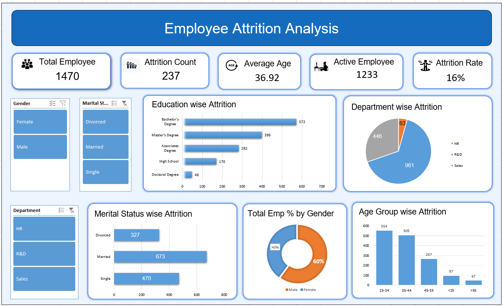

# HR Attrition Analysis

## Project Overview

The **HR Attrition Analysis** is an Excel-based HR analytics
project designed to summarize employee headcount, attrition, workforce
demographics, and department-level distribution. It converts
employee-level data into KPI cards, charts, and interactive slicers so
that users can explore the workforce and identify areas that may need
further HR attention.

## Business Problem

HR teams need a clear view of their workforce to monitor employee
retention and understand how the workforce is distributed across
departments and demographic groups. Reviewing employee records one by
one makes it difficult to identify patterns quickly.

This project organizes the HR data into an interactive dashboard that
helps answer questions such as:

-   How many employees are in the organization?
-   How many employees have left, and what is the overall attrition
    rate?
-   What is the average employee age?
-   How is the workforce distributed by department, gender, education,
    marital status, and age group?
-   Which employee segments may deserve closer investigation when
    studying attrition?

## Dashboard Preview

## Key Performance Indicators (KPIs)

  ------------------------------------------------------------------------
  KPI                                          
  --------------------- ---------------------------- ---------------------
  Total Employees                              1,470 Total employee
                                                     records in the
                                                     dataset

  Attrition Count                                237 Employees marked as
                                                     having left
                                                     (`Attrition = Yes`)

  Active Employees                             1,233 Employees marked as
                                                     current
                                                     (`Attrition = No`)

  Average Age                            36.92 years Average age of
                                                     employees

  Attrition Rate                                 16% Attrition count
                                                     divided by total
                                                     employees
  ------------------------------------------------------------------------

**KPI calculations**

-   **Active Employees** = Total Employees − Attrition Count
-   **Attrition Rate** = (Attrition Count ÷ Total Employees) × 100
-   **Average Age** = Average of the `Age` field

## Dashboard Visualizations and Filters       
 * Education-wise employee distribution :-              Employee count across Bachelor's,
                                                      Master's, Associate's, High School,
                                                      and Doctoral education categories

  * Department-wise employee distribution:-            Employee count in HR, R&D, and
                                                    Sales

  * Marital-status distribution :-          Employee count for Divorced,
                                      Married, and Single employees

  * Gender distribution :-                  Workforce split by Male and Female
                                      employees

  * Age-group distribution :-              Employee count across the age bands
                                      shown in the dashboard

  * Gender slicer :-                      Filters the dashboard by gender

  * Marital Status slicer :-               Filters the dashboard by marital
                                      status                                  
   
* Department slicer :-                 Filters the dashboard by department                                 

  -----------------------------------------------------------------------

## Dataset Information

The Excel workbook contains **1,470 employee records and 48 columns** in
the `Data` sheet. The fields cover areas such as:

-   Employee and attrition information
-   Department, job role, and education field
-   Gender, age, and marital status
-   Business travel and overtime
-   Job satisfaction and environment satisfaction
-   Monthly income, daily rate, and salary hike
-   Years of experience and tenure-related fields

The workbook also contains supporting sheets for KPI calculations,
employee details, and category-wise summaries used by the dashboard.

## Tools and Techniques

-   **Microsoft Excel** -- data review, KPI calculations, pivot tables,
    charts, and dashboard creation
-   **Pivot Tables / Pivot Charts** -- summarizing employee data by
    categories
-   **Slicers** -- interactive filtering by gender, marital status, and
    department
-   **Excel formulas** -- KPI calculations such as active employee
    count, average age, and attrition rate
-   **Data visualization** -- presenting workforce metrics in an
    easy-to-read dashboard

## Key Findings from the Dataset

The following figures are calculated from the employee-level `Data`
sheet:

-   The dataset contains **1,470 employees**, including **237 employees
    with attrition** and **1,233 current employees**.
-   The overall attrition rate is approximately **16.1%** (displayed as
    16% on the dashboard).
-   The **R&D department** has the largest headcount (961 employees),
    followed by Sales (446) and HR (63).
-   The **25--34 age group** is the largest age segment in the source
    data (554 employees).
-   Single employees account for 120 of the 237 attrition cases; this is
    the largest attrition count among the marital-status groups.
-   Employees marked for overtime account for 127 attrition cases out of
    416 employees in that group.

## How to Use the Project

1.  Download or clone this repository.
2.  Open the Excel workbook in Microsoft Excel.
3.  Go to the `dashboard` sheet to view the HR Attrition Analysis
    Dashboard.
4.  Use the Gender, Marital Status, and Department slicers to filter the
    dashboard.
5.  Review the KPI cards and charts to explore workforce distribution
    and attrition metrics.

## Project Objective

The objective of this project is to demonstrate practical HR Attrition
analysis and Excel dashboarding skills by transforming employee-level
data into meaningful workforce metrics and interactive visual summaries.

------------------------------------------------------------------------
